

  <a href="https://yiaany.vercel.app/">
    <picture>
      <source media="(max-width: 600px) and (prefers-reduced-motion: reduce)" srcset="./assets/hero-mobile.svg">
      <source media="(prefers-reduced-motion: reduce)" srcset="./assets/hero.svg">
      <source media="(max-width: 600px)" srcset="./assets/hero-mobile.gif">
      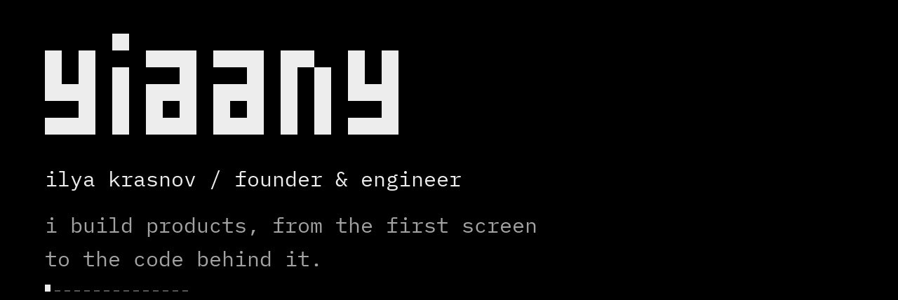
    </picture>
  </a>
  <a href="https://tarfio.com"><picture><source media="(max-width: 600px)" srcset="./assets/tarfio-mobile.svg">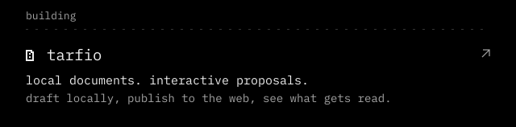</picture></a>
  <a href="https://soberui.com"><picture><source media="(max-width: 600px)" srcset="./assets/soberui-mobile.svg">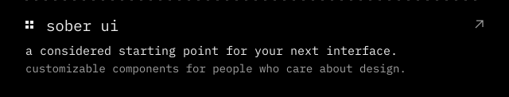</picture></a>
  <a href="https://gitmsg.fun"><picture><source media="(max-width: 600px)" srcset="./assets/gitmsg-mobile.svg">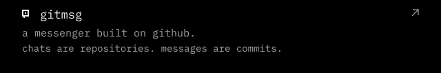</picture></a>
  <a href="https://github.com/yiaany/ghostapi"><picture><source media="(max-width: 600px)" srcset="./assets/ghostapi-mobile.svg">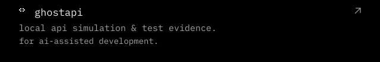</picture></a>
  <a href="https://github.com/yiaany/Mekka"><picture><source media="(max-width: 600px)" srcset="./assets/mekka-mobile.svg">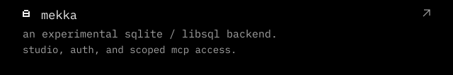</picture></a>
  <picture><source media="(max-width: 600px)" srcset="./assets/contributions-mobile.svg"></picture>
  <a href="https://github.com/google/adk-go/pull/1440"><picture><source media="(max-width: 600px)" srcset="./assets/adk-mobile.svg">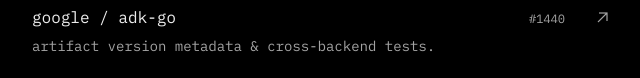</picture></a>
  <a href="https://github.com/apache/datafusion/pull/24792"><picture><source media="(max-width: 600px)" srcset="./assets/datafusion-mobile.svg">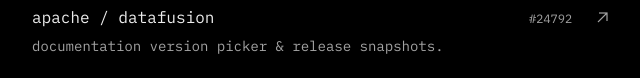</picture></a>
  <a href="https://github.com/cline/cline/pull/13721"><picture><source media="(max-width: 600px)" srcset="./assets/cline-mobile.svg">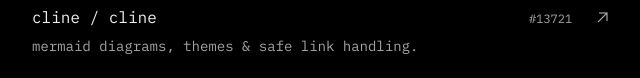</picture></a>
  <picture><source media="(max-width: 600px)" srcset="./assets/stack-mobile.svg">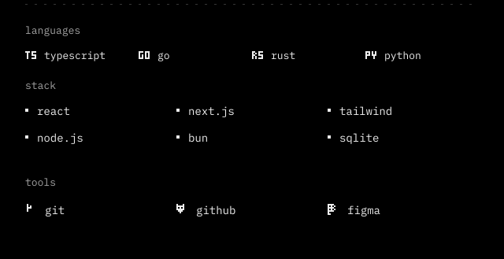</picture>
  <a href="https://yiaany.vercel.app/"><picture><source media="(max-width: 600px)" srcset="./assets/contact-mobile.svg">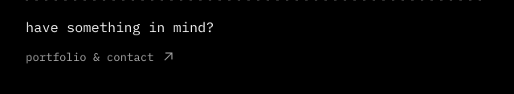</picture></a>

