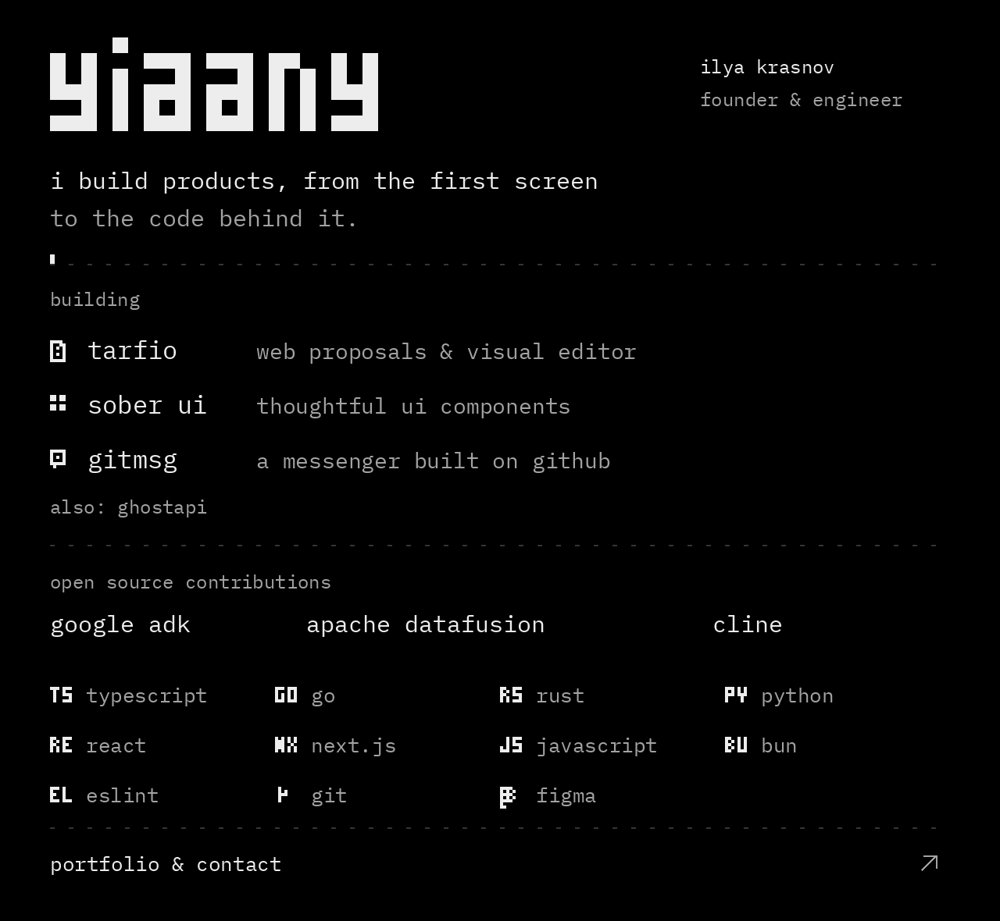

  <a href="https://yiaany.vercel.app/">
    <picture>
      <source media="(max-width: 600px) and (prefers-reduced-motion: reduce)" srcset="./assets/profile-compact-mobile.svg">
      <source media="(prefers-reduced-motion: reduce)" srcset="./assets/profile-compact.svg">
      <source media="(max-width: 600px)" srcset="./assets/profile-compact-mobile.gif">
      
    </picture>
  </a>

